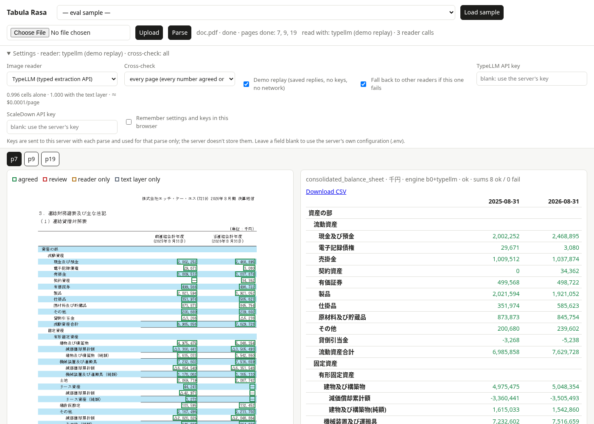
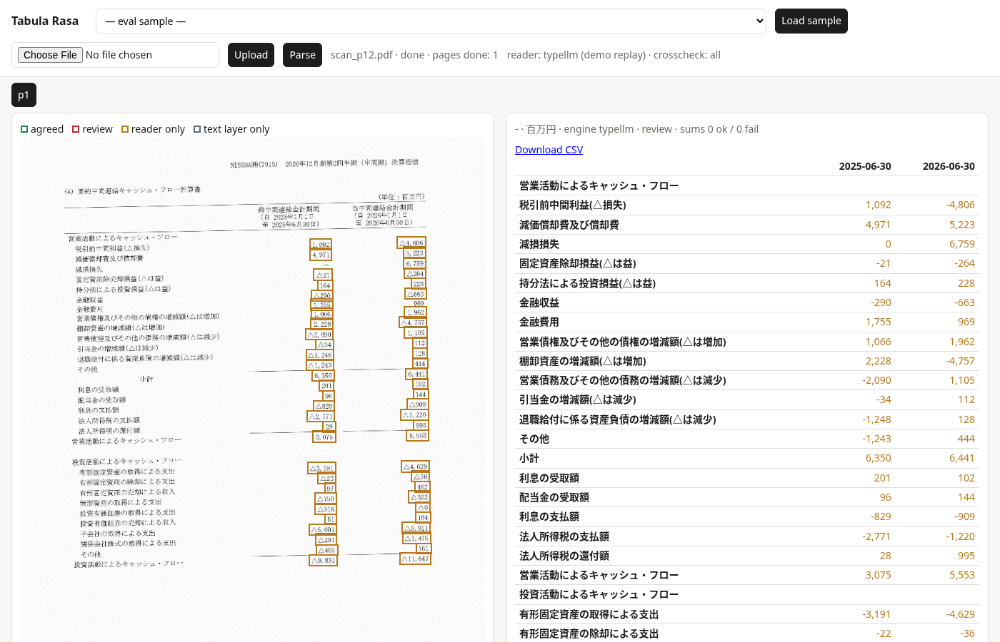
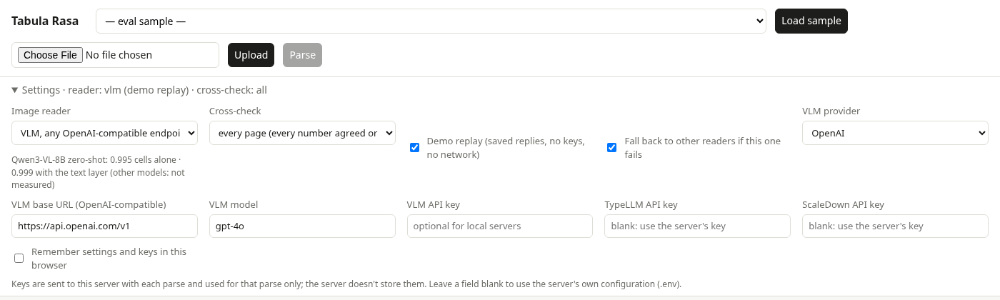

# Tabula Rasa

**Turn Japanese financial-filing PDFs into correct, typed tables, and show which numbers you can trust.**

Tabula Rasa reads each statement page of a 決算短信 or 有価証券報告書 (balance sheet, P/L, cash flow, including 訂正 filings and scans). It returns a table with row hierarchy, periods, units and signed values. Every number is read twice: once from the PDF's text layer, once from the page image. A number is approved only when both readings agree.



| On 85 real filing pages (4,619 numbers checked against XBRL) | |
|---|---|
| Numbers correct | **100%** (4,619 / 4,619) |
| Pages fully correct | **93%** (79 / 85) |
| Numbers approved automatically (both readers agree) | **92%**, all of them correct |
| Cost per page | ≈ $0.0001 (one TypeLLM call) |

Details, comparisons and method: [REPORT.md](REPORT.md).

---

## Contents

- [Features](#features)
- [Quick start (demo, no keys)](#quick-start-demo-no-keys)
- [Installation](#installation)
- [Choosing a mode](#choosing-a-mode)
- [Usage](#usage): [web app](#web-app) · [command line](#command-line) · [Python](#python) · [HTTP API](#http-api)
- [Configuration](#configuration)
- [Output](#output)
- [How it works](#how-it-works)
- [Security](#security)
- [Evaluation](#evaluation)
- [Development](#development)
- [Troubleshooting](#troubleshooting)
- [Project layout](#project-layout)

## Features

- **Statement tables to JSON, CSV and HTML.** Row hierarchy (資産の部 › 流動資産 › 現金及び預金) and row types (item, contra, net, subtotal, total). Periods as dates, units (千円 / 百万円), and signs from △ / ▲ / （ ）.
- **A status on every number:** `agreed`, `review`, `reader_only` (scans) or `b0_only`. Only disagreements and scans need a person.
- **Sum checks with no labels needed.** 合計 and 小計 rows and J-GAAP profit lines are checked, allowing for the filing's rounding rule (切り捨て / 四捨五入). Statements split across pages are joined, and 資産合計 = 負債純資産合計 is checked.
- **Handles real-world filings:**
  - scans (no text layer)
  - permission-locked and font-less EDINET PDFs
  - 和暦 dates
  - IFRS note-number columns
  - per-share rows in 円
- **Resists hidden-text and prompt-injection attacks.** Only text that is visibly painted on the page can become a value.
- **Web viewer:** page image with colour-coded cell boxes next to the table; click a box to find its row.
- **Cheap by design:** a free local pass first, a cached image reader second, and automatic fallback between readers.

## Quick start (demo, no keys)

```bash
git clone https://github.com/Kamrulhasan12345/tabula-rasa.git
```

```bash
cd tabula-rasa && python3 -m venv .venv && .venv/bin/pip install -r requirements.txt
```

```bash
TABULA_DEMO=1 .venv/bin/uvicorn tabula.server:app --port 8765
```

Open **http://localhost:8765**, choose a sample, click **Load sample**, then **Parse**.

- Demo mode replays saved reader replies, so it needs no API keys and no network, and costs nothing.
- A fresh clone ships one sample: the balance sheet in `docs/`. The other eval filings appear in the list only if their PDFs are in `data/` (not in git, for licence and size reasons).
- You can also upload any PDF. Pages outside the eval set are read from the text layer only in demo mode.



Direct links work too, e.g. `http://localhost:8765/?sample=balance_sheet_after_correction&page=1`.

## Installation

**Requirements**

| | |
|---|---|
| Python | 3.11+ (developed on 3.13) |
| OS packages | `qpdf` (opens permission-locked PDFs), a CJK font such as Noto CJK (EDINET PDFs often don't embed fonts) |
| RAM | ~1.5 GB free (OCR for the security check uses ~600 MB per page) |
| GPU | not needed |

```bash
sudo apt install qpdf fonts-noto-cjk
```

On Arch: `sudo pacman -S qpdf noto-fonts-cjk`. On macOS: `brew install qpdf`; macOS already has CJK fonts.

```bash
python3 -m venv .venv && .venv/bin/pip install -r requirements.txt
```

`uv pip install --python .venv/bin/python -r requirements.txt` works too.

**API keys (optional).** Copy the template and fill in what you have:

```bash
cp .env.example .env
```

With `TYPELLM_API_KEY` set, TypeLLM becomes the image reader. Without any key, pages are read from the text layer alone (`b0_only`) unless `TABULA_DEMO=1`.

## Choosing a mode

Every mode can be picked per parse: in the viewer's **Settings**, with CLI flags, or in the API request body. Anything you leave unset falls back to the server's `.env`.

| Image reader | What it is | Measured on the eval set | Needs |
|---|---|---|---|
| `typellm` (default with a key) | TypeLLM typed-extraction API | 0.996 cells alone, **1.000 with the text layer**, ≈ $0.0001/page | `TYPELLM_API_KEY` |
| `scaledown` | ScaleDown Extract API | 0.720 cells (drops rows/columns on dense statements) | `SCALEDOWN_API_KEY` |
| `vlm` | any OpenAI-compatible vision model: local vLLM, OpenAI, Gemini, OpenRouter… | Qwen3-VL-8B: 0.995 alone, 0.999 with the text layer. Other models not measured | endpoint URL, model, key |
| `none` | text layer only | exact on born-digital pages; can't read scans; no cross-check | nothing |

| Option | Choices |
|---|---|
| Cross-check | `all`: every number agreed or flagged · `needed`: call the reader only where the text layer can't vouch (cheaper) |
| Demo replay | saved replies for the eval pages: no keys, no network |
| Fallback | if the chosen reader fails, try the others (TypeLLM, then ScaleDown, then VLM) |

**Bring your own VLM.** In the viewer, choose *VLM*, then pick a provider preset (local vLLM, OpenAI, Google Gemini, OpenRouter) or type any OpenAI-compatible base URL. Then set the model name and, if needed, a key.



**Keys entered in the viewer:**
- They are sent with that parse only. The server uses them for that request and never writes them to disk; `meta.json` only records which options were set.
- **Remember** keeps them in your browser's local storage. Leave it off on shared machines.
- On a shared server, set `TABULA_ALLOW_CLIENT_ENDPOINTS=0` so users can't make the server call arbitrary URLs.

## Usage

### Web app

```bash
.venv/bin/uvicorn tabula.server:app --port 8000
```

Open http://localhost:8000.
1. Upload a PDF (or load a sample) and click **Parse**.
2. Pages appear as they finish. Pick one to see the page with boxed cells, the table, sum checks and warnings, plus a CSV download.

| Box colour | Status | Meaning |
|---|---|---|
| green | `agreed` | text layer and image reader read the same number |
| red | `review` | they disagree, or the cell held hidden/unverified text: check by hand |
| amber | `reader_only` | scanned page, read from the image only |
| grey | `b0_only` | text layer only (image reader skipped or unavailable) |

### Command line

```bash
.venv/bin/python -m tabula docs/balance_sheet_after_correction.pdf -o out/
```

```bash
TABULA_VLM_KEY=sk-... .venv/bin/python -m tabula filing.pdf --reader vlm --vlm-url https://api.openai.com/v1 --vlm-model gpt-4o
```

```text
  p1: consolidated_balance_sheet | 43 rows, 74 cells, 0 to review | sums 12 ok / 0 fail | engine b0+typellm | ok -> out/balance_sheet_after_correction_p1.csv
docs/balance_sheet_after_correction.pdf: reader typellm | crosscheck all, 1 reader calls | table pages [1]
```

| Option | Meaning |
|---|---|
| `-p 3,5` | only these pages (default: every page that prints 単位 and has a numeric table, plus image-only pages) |
| `-o DIR` | output folder; each page gets `.json`, `.csv` (Excel-ready UTF-8 BOM) and `.html` |
| `--doc-id ID` | id for demo replay of an eval filing, e.g. `--doc-id 081220261008548219` |
| `--reader R` | `typellm` / `scaledown` / `vlm` / `none` |
| `--vlm-url URL --vlm-model M` | use any OpenAI-compatible VLM; key from `TABULA_VLM_KEY` |
| `--crosscheck all\|needed`, `--demo`, `--no-fallback` | as in [Choosing a mode](#choosing-a-mode) |

### Python

```python
from tabula.api import parse_pdf, to_csv

result = parse_pdf("filing.pdf")            # or pages=[7, 9]
# any option, per call (same names as .env):
result = parse_pdf("filing.pdf", settings={"TABULA_READER": "vlm", "TABULA_VLM_URL": "http://localhost:8000/v1",
                                            "TABULA_VLM_MODEL": "Qwen/Qwen3-VL-8B-Instruct", "TABULA_CROSSCHECK": "needed"})
for page in result["pages"]:
    print(page["page"], page["statement_type"], page["status"])
    print(to_csv(page))
print(result["statements"])                 # pages joined into statements, with balance checks
```

### HTTP API

Interactive docs: `/docs` (OpenAPI). Parsing runs in the background; poll the document for progress.

| Method | Path | What |
|---|---|---|
| `POST` | `/documents` | upload (multipart `file`, optional `name`); returns `id`, page count, table pages |
| `POST` | `/documents/{id}/parse` | start parsing (202); optional JSON body below |
| `GET` | `/readers` | readers with measured accuracy and whether this server has them configured |
| `GET` | `/documents/{id}` | `state` (uploaded / queued / running / done / failed), `pages_done`, `statements` |
| `GET` | `/documents/{id}/pages/{n}` | page JSON |
| `GET` | `/documents/{id}/pages/{n}.csv` / `.html` | the same table as CSV / HTML |
| `GET` | `/documents/{id}/pages/{n}/image.png?dpi=100` | page image; a box in px = PDF points × dpi / 72 |
| `GET` | `/samples`, `POST /samples/{key}` | eval filings available on this machine |
| `GET` | `/health` | reader in use, demo flag, crosscheck mode |

```bash
curl -F file=@docs/balance_sheet_after_correction.pdf localhost:8000/documents
```

```bash
curl -X POST localhost:8000/documents/<id>/parse -H 'Content-Type: application/json' -d '{"reader": "scaledown", "crosscheck": "needed"}'
```

The parse body (every field optional):
- `pages`, `reader`, `crosscheck`, `demo`, `fallback`
- `vlm_url`, `vlm_model`, `vlm_key`
- `typellm_key`, `scaledown_key`

```bash
curl localhost:8000/documents/<id>/pages/1
```

Uploads are treated as untrusted:
- only real PDFs up to 50 MB are accepted
- ids are content hashes, and names are sanitized
- one document is parsed at a time

## Configuration

All settings are environment variables. Put them in `.env`, which is loaded automatically; see [.env.example](.env.example). These are the server's defaults; each parse can override them ([Choosing a mode](#choosing-a-mode)).

| Variable | Default | Effect |
|---|---|---|
| `TYPELLM_API_KEY` | – | enables TypeLLM, the default image reader |
| `SCALEDOWN_API_KEY` | – | enables ScaleDown Extract (fallback reader) |
| `TABULA_READER` | `typellm` if its key is set, else `vlm` | `typellm` / `scaledown` / `vlm` / `none` |
| `TABULA_FALLBACK` | `1` | `0`: don't try other readers when the chosen one fails |
| `TABULA_ALLOW_CLIENT_ENDPOINTS` | `1` | `0`: reject VLM URLs sent in requests (shared servers) |
| `TABULA_DEMO` | off | `1`: every reader replays saved replies (eval pages); no network |
| `TABULA_CROSSCHECK` | `all` | `needed`: call the reader only when the text layer can't vouch for a page (scan, unverified text, failing sum, undated column) |
| `TABULA_READER_CONCURRENCY` | `4` | reader calls in flight while the local pass runs |
| `TABULA_CACHE` | `runs/cache` | reply cache keyed by page-image hash: a page is never billed twice |
| `TABULA_VLM_URL`, `TABULA_VLM_MODEL`, `TABULA_VLM_KEY` | – | self-hosted VLM via an OpenAI-compatible endpoint, e.g. `vllm serve Qwen/Qwen3-VL-8B-Instruct` |
| `TABULA_AMOS` | off | `1`: Amos checks disputed cells against the image (no key; sends images to amos.scira.ai) |
| `SQWISH_API_KEY` | – | Sqwish row-type classifier (optional evidence) |
| `TABULA_STORE` | `runs/store` | uploaded PDFs and results (server) |
| `TABULA_CORS_ORIGINS` | – | comma-separated origins allowed to call the API from a browser |

**Reader fallback:** if the chosen reader fails, the next one is tried: TypeLLM, then ScaleDown, then the VLM. If none answers, the page comes back from the text layer alone, with a warning.

## Output

One JSON object per page. Abridged, from the sample page:

```json
{
  "page": 1, "statement_type": "consolidated_balance_sheet", "scope": "consolidated",
  "unit": {"raw": "千円", "multiplier": 1000, "currency": "JPY"},
  "rounding": {"method": "unknown", "source": "none"},
  "columns": [{"id": "c0", "label": "前連結会計年度", "period_type": "instant", "period_end": "2025-03-31"},
              {"id": "c1", "label": "当連結会計年度", "period_type": "instant", "period_end": "2026-03-31"}],
  "rows": [{
    "id": "r17", "label": "減価償却累計額", "level": 4, "row_type": "contra",
    "path": ["資産の部", "固定資産", "有形固定資産", "建物及び構築物"],
    "raw": {"c0": "△1,923,585", "c1": "△1,640,253"},
    "values": {"c0": -1923585, "c1": -1640253},
    "cell_status": {"c0": "agreed", "c1": "agreed"},
    "cell_bbox": {"c0": [347.9, 341.8, 397.5, 350.8], "c1": [472.9, 341.8, 522.6, 350.8]},
    "unit_override": null
  }],
  "check_results": [{"total": "r13", "label": "流動資産合計", "column": "c0", "status": "ok", "diff": 3}],
  "status": "ok", "warnings": [], "security_flags": [], "engine": "b0+typellm"
}
```

- `values` are in the table unit (multiply by `unit.multiplier` for yen). `raw` keeps the printed text.
- `rounding` comes from the filing's note (切り捨て / 四捨五入) when the page prints one. Otherwise it is `unknown`, and sum checks use a tolerance of the number of items.
- `－` is 0, and an empty cell is `null`. Per-share rows carry `unit_override: "円"` and may be decimals.
- `cell_bbox` is `[x0, top, x1, bottom]` in PDF points with a top-left origin.
- The full schema is in PRD §4.

## How it works

```
PDF page
 ├─ security   only text visibly painted on the page is trusted (OCR cross-check)    local, free
 ├─ router     statement type, 連結/個別, standard, unit, periods, 訂正前/後
 ├─ B0         Camelot cells rebuilt from trusted words + Japanese label rules       local, free
 ├─ reader     page image → TypeLLM (or ScaleDown / VLM): demo replay → cache → API  ≈ $0.0001
 ├─ merge      cell by cell: agreed / review / reader_only / b0_only
 └─ checks     sums (合計, 小計, profit lines), rounding-aware; statements joined across pages
```

- **Values come from the text layer** where it can be trusted, because it is the filer's own text. The image reader confirms them.
- **Scans** are read from the image alone, and their cell boxes are found by OCR.
- **Nothing an API returns is accepted** just because it makes a sum balance. Sum failures only send the page to review.

## Security

Filing PDFs are untrusted input. A page can hide text that people can't see but parsers and LLMs read: white or tiny text, text under a box, off-page text, hidden layers, a fake number in the row-band colour. Tabula Rasa trusts a word only if:
- its font is at least 4 pt
- its contrast is visible
- it doesn't overlap another word
- OCR of the rendered page reads the same text at that spot

A cell with an untrusted word becomes `review`, never a value. Image readers get pixels only; the raw text layer is never sent to an LLM. On 11 poisoned test PDFs this caught every attack. Three public scanners each missed at least one: REPORT §5.

## Evaluation

The eval set has 85 pages: TDnet 決算短信, EDINET 有価証券報告書 and synthetic scans. Every number in the gold tables matches the filer's own XBRL.

```bash
.venv/bin/python -m tabula.run_eval b1 typellm scaledown hybrid_typellm
```

```bash
.venv/bin/python tools/by_group.py b0 b1 typellm scaledown hybrid hybrid_typellm
```

```bash
.venv/bin/python tools/calibration.py hybrid_typellm
```

Rescoring is free and offline: reader replies and B0 predictions are committed (`runs/`). Results and analysis: [REPORT.md](REPORT.md). Design, metrics and research: [docs/PRD.md](docs/PRD.md).

## Development

Each test prints `ok`. Run them one at a time; the OCR ones need ~600 MB.

| Test | Covers | Time |
|---|---|---|
| `tests/test_m0.py` | normalizer (△, －, 和暦, radicals), rounding-aware sums | s |
| `tests/test_m1.py` | security check on 11 poisoned PDFs, router | ~3 min |
| `tests/test_m2.py` | metrics and scoring | s |
| `tests/test_m3.py` | B0 on the sample page | ~30 s |
| `tests/test_hybrid.py` | merge, reader fallback, cache, demo replay | s |
| `tests/test_remote.py` | API adapters against a fake server (never spends credit) | s |
| `tests/test_api.py` | HTTP API end to end, viewer, samples | ~30 s |

```bash
.venv/bin/python tests/test_hybrid.py
```

Agents and contributors: start with [docs/PROGRESS.md](docs/PROGRESS.md), which covers state, open work, gotchas and conventions.

## Troubleshooting

| Symptom | Fix |
|---|---|
| Kanji missing; every word flagged `not-visible` on EDINET PDFs | install a CJK font (Noto CJK); those PDFs don't embed theirs |
| `camelot` / PDF permission errors | install `qpdf`; locked PDFs are decrypted to a temp copy |
| Process killed (exit 137) | not enough RAM: run one parse at a time, close other heavy apps |
| Every cell is `b0_only` | no reader available: set `TYPELLM_API_KEY`, or `TABULA_DEMO=1` for eval pages |
| `reader_error` warnings | the API failed or timed out; the next reader was tried, and the page still has text-layer values |

## Project layout

| Path | What |
|---|---|
| `tabula/server.py`, `static/index.html` | HTTP API and the web viewer |
| `tabula/api.py` | `parse_pdf()`: pipeline, sum checks, statement stitching, CSV / HTML |
| `tabula/hybrid.py` | cell-by-cell merge; reader policy (demo, cache, fallback, crosscheck) |
| `tabula/b0.py`, `router.py`, `security.py` | local pass: tables from trusted words, page metadata, visibility check |
| `tabula/remote.py`, `vlm.py`, `b1.py` | image readers (TypeLLM, ScaleDown, Amos, Sqwish, VLM) and their output adapter |
| `tabula/normalize.py`, `checks.py` | number/date/label normalization; rounding-aware sum checks |
| `tabula/evaluate.py`, `run_eval.py`, `approaches.py` | metrics and the eval harness |
| `tools/` | data collection (TDnet, EDINET), XBRL gold builder, synthetic scans, report tables |
| `kaggle/` | VLM inference jobs (Qwen3-VL-8B, Unsloth, T4) |
| `gold/`, `runs/` | eval gold pages; saved predictions and reader replies |
| `docs/` | PRD, progress log, sample PDF, screenshots |

Built as a take-home for Ur AI (Document Intelligence & VLM R&D).

**Data licensing:**
- Filing PDFs and XBRL are not redistributed.
- The `tdnet` package (AGPL-3.0) is used only by the collection tools; it is not required to run the app.
